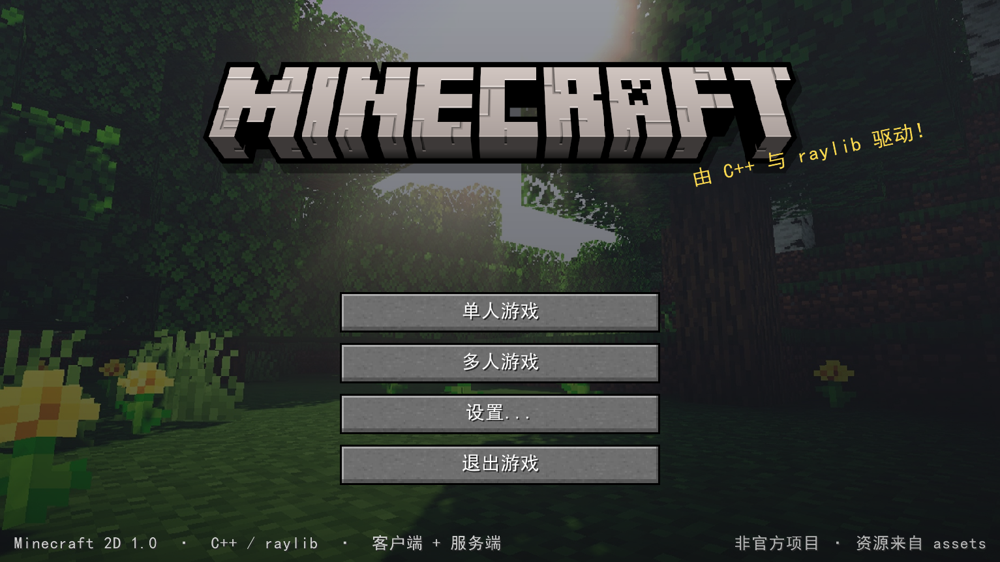
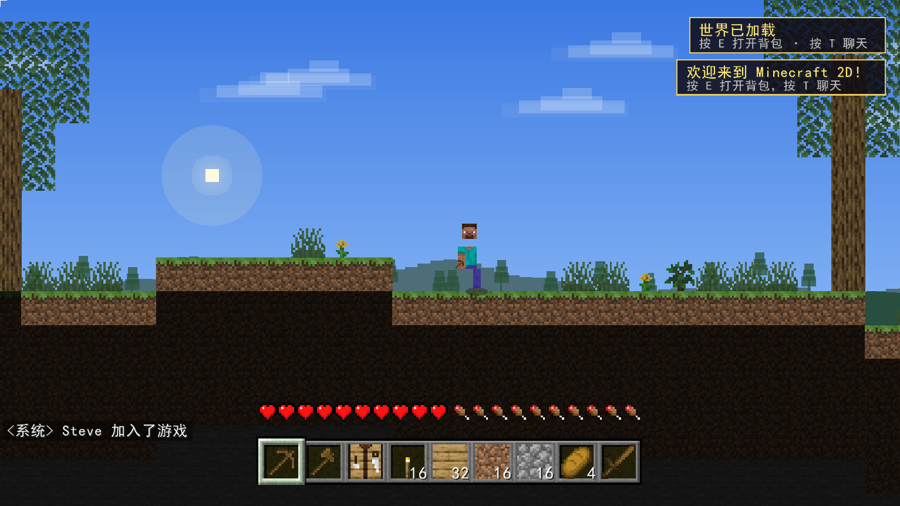
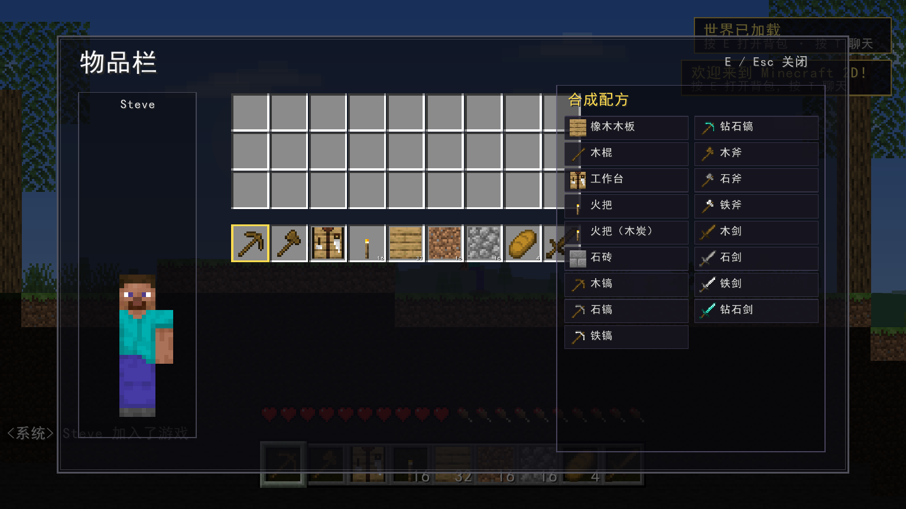

# Minecraft 2D

一个用 **C++17 + raylib** 制作的 2D 横版 Minecraft 风格沙盒。项目使用 `assets/` 中提供的原版材质，世界分为玩家所在的**前景方块层**和位于其后的**背景板（背景墙）层**，并带有远景山脉、树林、云层、太阳/月亮等视差背景。







架构为真正的**客户端 / 专用服务器双进程**：

- `mc2d_client.exe`：输入、预测、渲染、界面。
- `mc2d_server.exe`：权威世界、20 TPS 物理、挖掘/放置、背包、合成、生物、昼夜、存档。
- 两端通过 **TCP + 长度前缀 JSON** 通信。客户端本地预测自己的移动，服务器每 2 tick 广播快照，客户端用确认序号进行和解（reconciliation）。

## 运行

### 直接运行（已包含构建好的程序）

双击 **`start_game.bat`**，然后点击“单人游戏”。客户端会自动启动一个隐藏的本地专用服务器进程，退出游戏时会发送 `/stop` 保存并关闭它。

也可以手动开启专用服务器并在游戏里连接：

1. 双击 **`start_server.bat`**（默认端口 `25565`）。
2. 双击 **`start_game.bat`**，进入“多人游戏”，地址填写 `127.0.0.1:25565`，或直接使用“单人游戏”连接到已经运行的服务器。

服务器控制台支持输入 `help`、`save`、`list`、`time set day|night`、`say`、`stop`。

### 命令行

```bat
bin\mc2d_client.exe --singleplayer
bin\mc2d_client.exe --connect 127.0.0.1:25565 --name Steve
bin\mc2d_server.exe --port 25565
bin\mc2d_server.exe --port 25565 --fresh --seed 12345
```

可选参数：

- 客户端：`--singleplayer`、`--connect <host:port>`、`--name <名字>`、`--width/--height`。
- 开发辅助：`--screenshot <路径> --screenshot-delay <秒> --screenshot-ui inventory|debug|pause|death --quit-after-screenshot`。
- 服务器：`--port`、`--seed`、`--world <存档路径>`、`--fresh`。

## 构建

需要 Visual Studio 2022（含 C++ 桌面开发）、CMake 与 Windows SDK。raylib 已随仓库提供，nlohmann/json 从 `vcpkg_installed` 使用。

最简单的方式是双击 **`build.bat`**。或者：

```bat
cmake -S . -B build -G "Visual Studio 17 2022" -A x64
cmake --build build --config Debug --target mc2d_client mc2d_server
```

输出位于 `bin/`。当前 `bin/` 内已附带可运行的 Debug 构建。

## 操作（尽可能与原版一致）

| 按键 | 功能 |
| --- | --- |
| `A` / `D` | 向左 / 向右移动（2D 世界对应的横向移动） |
| `空格` | 跳跃 / 在水中上浮 |
| `左 Shift` | 潜行（会防止走出边缘）；创造模式飞行时下降 |
| `左 Ctrl` | 疾跑 |
| 双击 `A` / `D` | 疾跑 |
| 鼠标左键 | 攻击生物 / 按住挖掘方块 |
| 鼠标右键 | 放置方块 / 使用 / 进食 / 打开工作台界面 |
| `1`–`9` / 鼠标滚轮 | 选择快捷栏 |
| `E` | 打开 / 关闭背包 |
| `Q` | 丢弃当前快捷栏物品 |
| `T` / `Enter` | 聊天 |
| `/` | 输入指令 |
| `Tab` | 在线玩家列表 |
| `F1` | 隐藏 / 显示 HUD |
| `F2` | 截图（保存到 `screenshots/`） |
| `F3` | 调试信息 |
| `F5` | 切换镜头远近（2D 适配） |
| `F11` | 全屏 |
| `Esc` | 暂停 / 返回 |

创造模式：`/gamemode creative`，双击空格切换飞行。

## 已实现内容

- 程序化世界：512 × 128 方块，丘陵、沙漠、洞穴、矿脉、湖泊、橡树、花草。
- 前景方块层 + 背景墙层，地下被挖空后会露出后方的背景板。
- 视差远景、云层、太阳 / 月亮、星空、动态光照、火把光晕。
- 20 分钟的昼夜循环；夜晚会生成僵尸；白天有猪。
- 玩家 AABB 物理、跳跃、潜行、疾跑、游泳、坠落伤害、生命 / 饥饿 / 氧气。
- 挖掘速度与工具匹配、方块掉落物、物品吸附拾取、放置方块、攻击生物。
- 36 格背包、快捷栏、鼠标拖拽 / 分堆、Shift 快速移动、2 × 9 合成配方面板。
- 粒子效果、方块破坏裂纹、目标轮廓、伤害红屏、镜头抖动。
- 聊天、玩家列表、F3 调试、暂停、死亡与重生。
- 世界与玩家数据持久化：`saves/world.mc2d`、`saves/world.players.json`。
- 服务端指令：`/time set`、`/gamemode`、`/give`、`/tp`、`/spawn`、`/kill`、`/seed`、`/list`、`/save`、`/clear`、`/stop`。
- 原版风格的标题界面、按钮、快捷栏、生命 / 饥饿图标、物品材质、工作台配方。

## 目录结构

```
src/
  common/   blocks 定义、世界生成/存档、玩家物理、TCP 网络
  server/   专用服务器主循环、玩家/生物/方块逻辑、控制台
  client/   raylib 渲染、界面、预测与网络同步、Windows 进程辅助
assets/     方块、物品、界面、环境、字体等原版风格素材
bin/        mc2d_client.exe / mc2d_server.exe
build.bat   使用 CMake 构建
start_game.bat
start_server.bat
```

## 说明

- 这是一个非官方、非商业的同人项目，与原版 Minecraft 无隶属关系。
- 2D 横版中，原版的前后移动 (`W`/`S`) 不适用，因此使用 `A`/`D` 左右移动；跳跃仍是空格，潜行/疾跑/交互等键位尽量保持原版。
- 本项目只使用 `assets/` 中提供的图像素材；没有额外音频素材，因此当前没有音效。
- Debug 构建需要 MSVC 调试运行库；如果目标机器没有，可使用 `build.bat Release` 构建 Release 配置。
- 玩家数据按世界文件名分别保存，例如 `world.mc2d` 对应 `world.players.json`。
